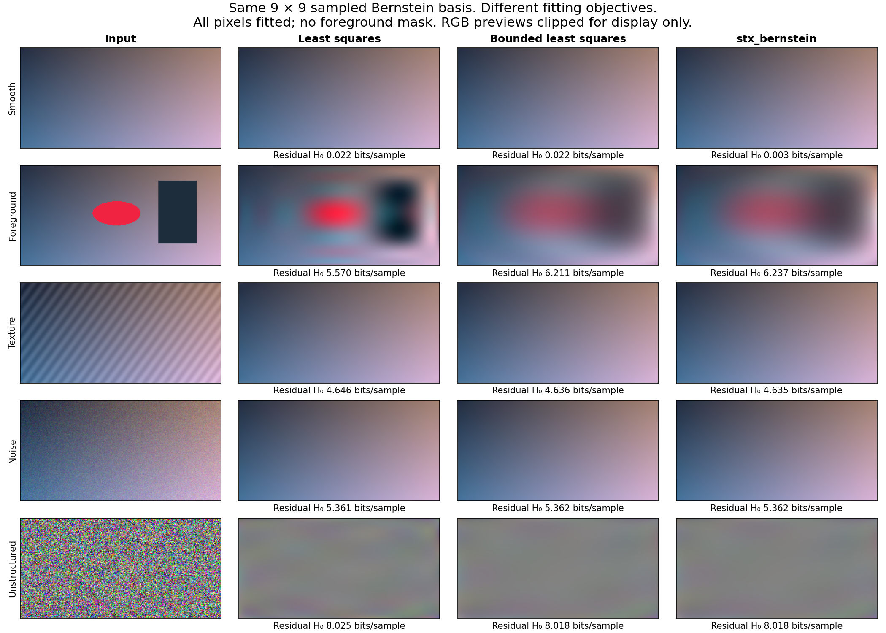
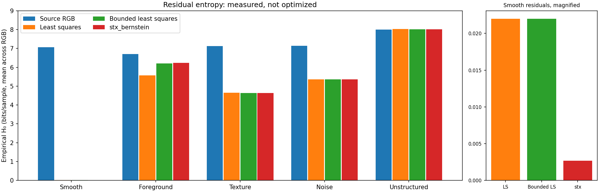
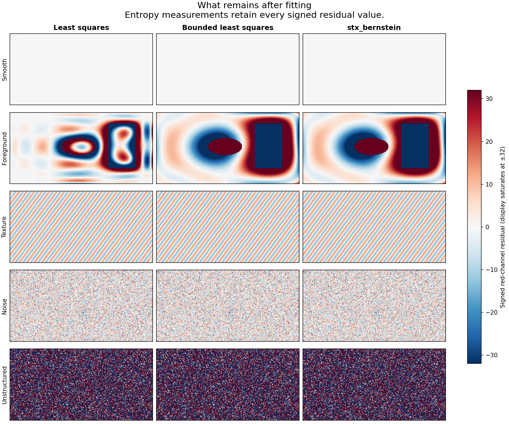

# Surface fitting, and what remains

A smooth surface can describe much of an image with only 81 controls per
channel. These demonstrations compare **how we fit that surface** and **how
much uncertainty remains in its signed residual**. They use five deterministic
256×128 RGB fixtures, generated entirely by the included script. No external
images, pretrained models or foreground masks are needed.

## 1. Conventional least squares versus quantization-aware fitting



All three methods use the library's same 9×9 sampled Bernstein basis, with
81 coefficients per channel:

| Method | Objective | Coefficient constraints |
| --- | --- | --- |
| Least squares | Squared error against pixel centers | Unrestricted binary64 |
| Bounded least squares | Squared error against pixel centers | Binary64, within [0, 255] |
| stx_bernstein | Squared distance to pixel intervals [value − 0.499, value + 0.499] | Within [0, 255], exported as Q8 |

The conventional polynomial baseline uses a Bernstein parameterization instead
of raw monomials. In exact arithmetic these span the same tensor polynomial
space: degree at most eight **in each axis**, not total degree eight. Here all
methods share the library's Q20 basis rounding, avoiding an additional basis
mismatch. Separate axis QR factorizations reduce the full-grid least-squares
problem to 81 equations without materializing a pixels-by-81 matrix. The bounded
control uses SciPy's bounded-variable least-squares solver on that same reduced
problem. It distinguishes coefficient constraints from the interval objective.

The baselines retain full-precision coefficients; the library uses its actual
Q8 output and native integer renderer. This measures the shipped representation,
not an idealized solver. All renderings use half-up pixel rounding. Numerical
metrics and residuals are **not clipped**; the fitted RGB previews above are
clipped only for display. Results include continuous and rounded error, interval
error, coefficient ranges, and error against the known synthetic background.

On the smooth fixture, least squares leaves **189 nonzero channel samples**;
`stx_bernstein` leaves **18**, out of 98,304. Matching pixel intervals helps the
rounded reconstruction even though conventional least squares has slightly
lower continuous squared error, as expected from its objective.

This is not a foreground-removal algorithm. On the foreground fixture, all
three fits are pulled toward the objects. Unrestricted least squares follows
more of their variation and leaves a smaller residual; the bounded methods stay
closer to the original smooth background, but do not recover it. The noisy and
textured fixtures demonstrate cases where the two bounded objectives differ
very little.

## 2. Residual entropy after fitting



Each residual is the original integer sample minus the rounded fitted sample.
Adding the fit back reconstructs every input sample exactly; the script checks
this for every method and fixture. We count signed residual values separately
in R, G and B and report their mean empirical zero-order entropy:

**H₀ = −Σ p(v) log₂ p(v), in bits per channel sample.**

This measures a histogram, not a compression format. It excludes the surface,
probability tables, spatial dependencies and coder overhead. Lower H₀ need not
mean a smaller file, and differences near 0.00001 bits/sample are not a useful
practical advantage on this fixture size. No claim about fitting speed follows
from this demonstration either; Python/SciPy is a numerical baseline, not a
competing optimized implementation.

| Fixture | Source RGB H₀ | Least-squares residual | Bounded LS residual | stx_bernstein residual |
| --- | ---: | ---: | ---: | ---: |
| Smooth | 7.05867 | 0.02198 | 0.02198 | **0.00267** |
| Foreground | 6.70572 | **5.56976** | 6.21065 | 6.23676 |
| Texture | 7.12576 | 4.64609 | 4.63595 | 4.63547 |
| Noise over background | 7.14696 | **5.36143** | 5.36173 | 5.36171 |
| Unstructured random RGB | **7.99428** | 8.02480 | 8.01840 | 8.01839 |

The smooth residual's H₀ falls about **88% relative to least squares**, but the
absolute difference is only 0.01930 bits/sample—about 237 ideal histogram-coded
bytes across this small image, before overhead. The library's 243 Q8 controls
alone occupy 486 bytes. The experiment does not establish a net compressed-size
win over a conventional image codec.

Random RGB is the useful counterexample: subtracting a varying surface can
expand the signed residual alphabet and increase its entropy. The solver does
not optimize entropy, and the examples retain that unfavorable result.



The residual visualization shows the red channel on a shared −32…+32 scale.
Larger residuals saturate visually only; every value contributes to the reported
entropy. White means zero. This avoids making a large residual look small by
independently stretching each panel.

## Reproduce

The demonstration calls the public C API through Python `ctypes`. Build a shared
library for this purpose; the ordinary build still defaults to a static library.

```sh
cmake -S . -B .build/demo -DCMAKE_BUILD_TYPE=Release -DBUILD_SHARED_LIBS=ON
cmake --build .build/demo --parallel
ctest --test-dir .build/demo --output-on-failure
python3 -m venv .build/demo-venv
.build/demo-venv/bin/python -m pip install -r demonstrations/requirements.txt
OPENBLAS_NUM_THREADS=1 OMP_NUM_THREADS=1 .build/demo-venv/bin/python \
  demonstrations/compare.py --library .build/demo/libstx_bernstein.dylib \
  --output .build/demo-results
```

Use `libstx_bernstein.so` on Linux; Windows shared-library output location depends
on the CMake generator. The recorded run used an Apple M4, LLVM 22.1.8 Release
build, binary64 arithmetic and `-ffp-contract=off`; core source revision
`2a4c47588757b24539bdc30494b490a87f5002dd`. Numerical results can vary across
compilers and numerical-library versions. The JSON records versions, platform,
script and library hashes, input hashes and full metrics. The seed is fixed at
20261024. The fixtures illustrate mechanisms; they are not a representative
natural-image corpus.

- [Complete numerical results](results/results.json)
- [Executable demonstration](compare.py)
- [Library objective and algorithm](../docs/ALGORITHM.md)

All fixture definitions, scripts and generated figures are included under the
repository's MIT license.
